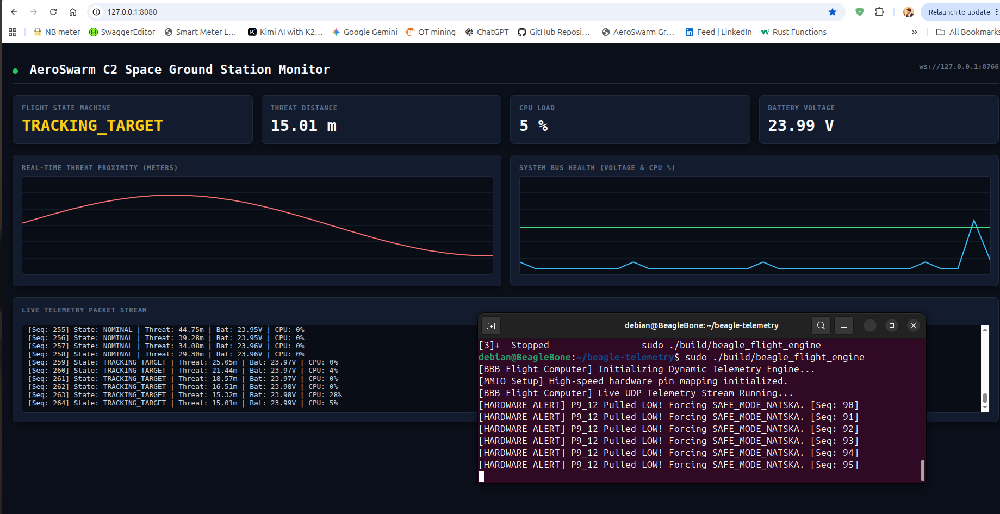

# AeroSwarm BBB Telemetry & Hardware Override Engine



A high-performance, low-latency telemetry and hardware safety override engine engineered for the **BeagleBone Black (AM335x SoC)** running Debian Trixie. This system bypasses standard kernel character device abstractions to perform direct physical register manipulation via `/dev/mem`, streaming real-time flight metrics over UDP to a C2 ground station dashboard.

---

## Key Technical Features

* **Direct Silicon MMIO Pinmuxing:** Bypasses missing userspace pin control utilities (`config-pin`) by directly mapping the AM335x Control Module (`0x44E10000`) and configuring pin **`P9_12`** (`gpmc_ben1`, offset `0x878`) to **Mode 7 + Receiver Active (`0x37`)**.
* **Zero-Syscall Hardware Polling:** Maps the GPIO1 module (`0x4804C000`) directly into process space to poll `GPIO_DATAIN` (offset `0x138`, bit 28) with deterministic, sub-microsecond latency.
* **Zero-Allocation System Metrics:** Parses `/proc/stat` on the fly without dynamic memory allocation (`malloc`) to calculate real-time CPU utilization.
* **Deterministic UDP Packet Streaming:** Transports packed telemetry structures securely across the RNDIS USB gadget interface (`192.168.7.2` $\rightarrow$ `192.168.7.1:8765`).

---

## Hardware Pin Mapping

| Expansion Pin | SoC Ball | GPIO Controller | Global GPIO | Function |
| :--- | :--- | :--- | :--- | :--- |
| **`P9_12`** | `gpmc_ben1` | `GPIO1_28` | **GPIO 60** | Hardware Safety Override (`SAFE_MODE_NATSKA`) |
The mapping from GPIO 60 (pin P9_12) to gpiochip1 line 28 is determined by the Texas Instruments AM335x SoC's hardware architecture, where GPIO pins are grouped into banks of 32 pins each.
Here is the exact mathematical relationship used to calculate the chip index and local line offset:
1. The Core Equation
Let  be the global GPIO number (). Since each GPIO bank contains 32 pins, the bank index (chip number) and local line offset are derived using integer division and modulo arithmetic:

$$\text{Bank Index} = \left\lfloor \frac{N}{32} \right\rfloor$$

$$\text{Line Offset} = N \pmod{32}$$
2. Step-by-Step Calculation
Applying this to GPIO 60:
    • Find the Chip Index (gpiochip number):
$$\left\lfloor \frac{60}{32} \right\rfloor = \left\lfloor 1.875 \right\rfloor = 1 \implies \mathbf{gpiochip1}$$
    • Find the Local Line Offset within the Bank:
$$60 \pmod{32} = 60 - (1 \times 32) = 60 - 32 = \mathbf{28}$$
This gives the exact arguments for the command: gpiochip1 and 28.

---

## Directory Structure

```text
beagle-telemetry/
├── include/
│   └── telemetry_packet.h   # Packed telemetry structures and wire protocol
├── src/
│   └── main.cpp             # MMIO register map, /proc/stat parser, UDP emitter
├── assets/
│   └── test_result.png      # Ground station C2 dashboard & hardware override log
└── README.md
Build Instructions
Ensure you have a modern C++17 compiler (g++) installed on your BeagleBone:

Bash
mkdir -p build
g++ -std=c++17 -Iinclude src/main.cpp -o build/beagle_flight_engine -lpthread
Test Instructions & Verification
Connect Ground Switch: Connect a tactile pushbutton or jumper wire between header pin P9_12 and ground (GND).

Launch Ground Station C2 Dashboard: Start your telemetry listener and web frontend on the host PC (192.168.7.1).

Execute Flight Engine: Run the binary with root privileges (required for /dev/mem MMIO mapping):

Bash
sudo ./build/beagle_flight_engine
Trigger Hardware Override: Ground pin P9_12. The engine will instantly detect the register state transition and force SAFE_MODE_NATSKA over the UDP stream.

Test Result & Verification
Live execution showing instantaneous hardware override response upon grounding P9_12:

License
This project is open-source under the MIT License.

Test sequences:
Step 1: Start the Python Bridge (Terminal 1)
Open your first terminal on your PC/Host machine to launch the bridge, which listens for incoming binary UDP packets from the BeagleBone Black and exposes a WebSocket server:
Bash
cd ~/aeroswarm-telemetry
python3 bridge.py

    • Expected Output: [WebSocket] Bridge listening on ws://127.0.0.1:8766 and [UDP Bridge] Listening on 0.0.0.0:8765...
Step 2: Start the Web Dashboard Server (Terminal 2)
Open a second terminal on your PC to serve the Mission Control UI:
Bash
cd ~/aeroswarm-telemetry/web
python3 -m http.server 8080

    • Action: Open your browser and go to http://127.0.0.1:8080. The status dot will turn green, indicating a successful WebSocket connection.
Step 3: Run the BBB Flight Engine (Terminal 3 - on BeagleBone Black)
Open your third terminal connected to your BeagleBone Black, compile (if not already done), and launch the updated flight engine configured for the P9_12 button:
Bash
cd ~/beagle-telemetry
g++ -std=c++17 -Iinclude src/main.cpp -o build/beagle_flight_engine -lpthread
sudo ./build/beagle_flight_engine

